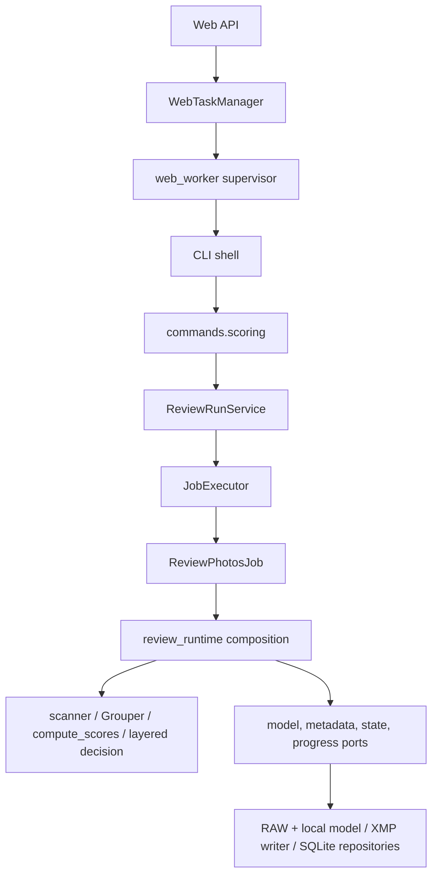

# 01 · 产品、入口与端到端流程

## 产品输入与产物

一次评分以显式输入目录、经过规范化的配置和照片文件为输入。当前 `config.yaml` 默认发现 `ARW, CR3, NEF, RAF, DNG, ORF, RW2`；`scan_arw_files()` 是历史命名，实际按配置扩展名递归扫描。输出分为三类：每张照片的分数/场景/决策和组元数据；应用状态库中的 session/job/artifact/cache；真实写出模式下的 XMP sidecar 投影。输入文件本身并不因扫描或评分而重编码。

默认后端 `local` 提供确定性本地评分，且可以在不安装可选模型包时运行。CPU 是默认设备与 fallback；OpenVINO 优先服务 Intel 路径，但配置中的设备选择和运行时实际执行设备是两件事。不要从镜像标签或配置值推断某次任务确实用了 GPU。

典型 CLI 操作是对已整理目录执行 `material-agent run /photos/目录 --config ...`，先读结果，再决定是否复跑维护命令。Web 用于 operator 检查与 dry-run 预览，不写源照片 sidecar。人工标注 viewer 与本地 benchmark 属于独立工具。

## 首次 CLI run：从空状态到写出

1. CLI shell 在 [`shells/cli/main.py`](../../src/material_agent/shells/cli/main.py) 解析 `run` 参数；轻量 [`main.py`](../../src/material_agent/main.py) 保持对旧导入/API 的兼容转发，并不承载另一套业务逻辑。
2. [`commands/scoring.py`](../../src/material_agent/commands/scoring.py) 读取 YAML，运行 `normalize_config()`、模型选择和 `validate_config()`；每次运行的 `input_dir`、`reprocess` 从调用参数来，不由持久配置悄悄指定。校验输入目录和 ExifTool 等运行前置条件。
3. 获取 work directory 独占运行锁、初始化 runtime 与 processed repositories、整理上次未终结的记录，然后递归发现目标扩展名。扫描和分组获得完整当前照片集合。
4. `ReviewRunService.run()` 创建 session/job，并把组合好的 collaborators 交给 `ReviewPhotosJob.run()`。分组先完成，随后逐组准备照片；cache miss 才解码与评分。写出模式逐文件构建 projection、调用 XMP writer、记录 job artifact/状态，最后更新 processed 的 `done` 记录。
5. 作业按 bounded batch 提交 runtime 写入。一次运行出现错误可以成为 `finished_with_errors`；中断是 `cancelled`，不能等同 `failed`。更早已提交批次仍留在状态库，可供后续增量运行复用。

典型命令（路径由操作者提供）：

```bash
material-agent run /photos/2026-trip --config /config/config.yaml
```

CLI 的默认写出模式会写入 sidecar；运行前应确认输入范围和配置。这份指南不执行真实任务。

## 后续缓存 / 增量运行

默认运行仍发现目录中的全部支持文件，并把已经 `done` 的文件传给分组器。processed repository 按照片路径查找记录，并核对源文件 `file_size`/`mtime_ns` 与 score cache key；符合条件可复用分数。新照片加入后，分组成员、组 rank 或终端投影可能变化，即使旧照片像素分数复用，也会更新受影响的组元数据。正常 unchanged `done` 结果跳过重复 sidecar 写入。

| 路径 | 解码/评分 | XMP | SQLite 结果 |
| --- | --- | --- | --- |
| 首次或 cache miss | 运行 | 写出模式执行 | runtime 与 processed 写入 |
| 命中 `done` 且分组/输出不变 | 跳过 | 跳过 | 保留完成记录，可追加本轮 job 观察 |
| cache key / 文件指纹失配 | 重新评分 | 写出模式按当前 projection 执行 | 新结果替换/更新 processed 投影 |
| `--reprocess` | 强制重新处理目标 | 写出模式执行 | 重建当前评分结果；仍受 XMP ownership/外部变化守卫 |
| Web dry-run | miss 评分，hit 可复用 | 永不写源 XMP | 写 runtime/artifact；不写 processed score/done |

未配置独立工作目录时，默认落点是照片目录下的 `.material-agent/state.db`；目录不可写时不会自动改用另一个位置。普通 CLI `run` 可通过 `MATERIAL_AGENT_WORK_DIR` 指向 appdata；Web 使用必需的 `--work-dir`。具体运行位置依据 `ensure_runtime_paths()`。

## Web dry-run：按钮/API 到详情页

1. 静态 dashboard (`src/material_agent/web/app.js`) 调用 Web API。`WebTaskManager.start()` 复制并验证运行配置，固定 `--dry-run`，创建私有 task snapshot/log 和两份租约，再启动 [`web_worker.py`](../../src/material_agent/app/web_worker.py) 监督进程；监督进程启动实际 CLI。library browse 使用索引路径解析和缩略图生成，不接受任意文件路径。
2. 子进程照常扫描、分组、评分、组内 finalize，并把 job、job_file、event 与 `score_payload` 写入 runtime SQLite。首次新评分的 dry-run 调用 writer projection 构造逻辑，但仅把 rating、tags、instructions、description、group 字段和 `xmp_projection` 等 preview 放进 artifact；不会替换 sidecar，也不写 processed `done` 行。
3. 列表/详情读取 library index 与最新 job-file artifact，展示 thumbnail、score、scene、decision、group 信息和可用 `output_preview`。这让 operator 能在真实写入前检查计划结果。
4. 监督进程写入实际退出回执；manager 在生命周期租约释放后汇总终态。API 取消写私有请求，由监督进程向自己尚未回收的 CLI 进程组发送 SIGTERM，manager 不向保存的 PID 发信号。CLI 处理取消时返回 130 并落 `cancelled` runtime 状态。若取消请求与自然完成/失败相撞，实际退出码 0/其他非零结果优先，不会仅因发出取消请求就改成 cancelled。

当前有两条重要异常分支：

- R1 修复后，manager 重启按匹配的私有租约/回执对账，不能把仍有生命周期持有者的任务误报为已结束。监督进程退出而 CLI 仍在时，会保持 `unknown`、拒绝无效取消并阻止新任务；旧 PID-only 状态也不会授权发信号。证据不足不是完成态，整容器/任意进程树恢复仍有单独边界。
- 匹配的 processed `done` cache hit 若组信息不变，会走跳过路径而不调用 writer projection。结果仍为 `skipped`，最新 artifact 可能缺 `output_preview`，详情页因此显示空 tag/描述提示。这与 Web operations 契约希望的 dry-run preview 有偏差，当前未修复。

R1 将外部 SIGTERM 经 CLI 转换后的退出码 130 同样报告为 cancelled；无法确认的退出结果保持 unknown/interrupted，不猜测 SQLite 内容。生命周期与缓存预览的历史问题见 [review](../operations/2026-10-22-repository-review.md)，各修复的实际进度见 [follow-up](../operations/2026-10-22-follow-up-plan.md)。

## 高层调用链



`core/` 下 `Pipeline`, `Grouper`, `ScoringEngine` 是早期兼容包装/导入入口；生产 job 走 `domain/`, `app/`, `commands/` 的路径。`clients/ollama.py`, `clients/omlx.py` 和 `adapters/models/{ollama,omlx}` 也仍可见，但属于显式 legacy/teacher 兼容能力，默认 local 主流程不选择它们。
