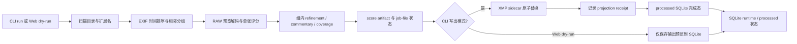

# material-agent 工作流程指南

> 面向使用者的源码导读。本文按 **代码快照 `24423c403aff29190d1ad3272b0035277ecd6132`（2026-10-22）**描述实现，不代表部署环境正在运行该版本。遇到本文与该快照的代码差异时，以代码和测试为准，并请在 review 中标出。

## 十分钟了解

`material-agent` 是一个以本地/NAS 照片目录为输入的选片与元数据辅助工具：扫描照片，按拍摄时间和相邻画面相似度组成小组，对可读预览计算技术与视觉分数，按组生成选择状态，再把结果写到 XMP sidecar 并登记在 SQLite。默认 `backend: local`，无需 Ollama、OMLX 或远程模型服务；CPU 是可用基线，Intel OpenVINO 是优先加速路径。实际模型是否启用取决于配置、资源和运行时证据。

内置 WebUI 是 **admin/operator dashboard**：索引只读照片库、启动始终为 dry-run 的评分子进程、检查任务与日志、浏览已保存分数/缩略图/输出预览、维护配置和受管理模型。它不是离线人工标注 viewer。仓库中的 human-reference viewer / benchmark harness 是实验或评估辅助工具，不属于主产品评分流程。

主流程速览：

图中 SQLite runtime 与 processed 是同一 DB 文件上的两套 repository/连接职责；XMP 与 DB 不是跨资源原子事务。

## 建议阅读顺序

| 章节 | 内容 |
| --- | --- |
| [01 产品、入口与端到端流程](01-product-and-flow.zh-CN.md) | CLI fresh/cache/reprocess 与 Web dry-run 的具体路径、取消/重启分支 |
| [02 发现、预览与分组](02-discovery-preview-grouping.zh-CN.md) | RAW、EXIF、方向/尺寸、focus、相邻 AND pHash 语义 |
| [03 评分、选择与解释字段](03-scoring-and-decisions.zh-CN.md) | 计算顺序、默认/可选模型、quality 与 selection 的边界 |
| [04 推理生命周期与资源](04-inference-runtime.zh-CN.md) | OpenVINO/CPU fallback、设备证据、缓存、准备窗口与内存观测 |
| [05 SQLite、缓存与恢复](05-state-cache-recovery.zh-CN.md) | runtime/processed 表、状态、指纹、batch、取消与恢复边界 |
| [06 XMP 输出与保护边界](06-xmp-output.zh-CN.md) | 投影构建、原子替换、receipt、用户字段保护与失败语义 |
| [07 Web、配置、模型与安全边界](07-web-config-models.zh-CN.md) | API/dashboard、配置快照、模型 registry、工作目录与 trusted LAN |
| [08 维护命令、容器与模块索引](08-operations-source-index.zh-CN.md) | CLI/benchmark/deployment 边界、源码/测试索引、术语与 review 问题 |

## 当前实现与证据边界

这份指南基于上述源代码快照；所列测试是可定位的回归证据，不等同于本指南重新执行了每项测试、真实照片验收或目标主机部署。默认值以仓库 `config.yaml` 和归一化/校验代码为准，运行实例可能有自己的私有配置。

2026-10-22 [repository review](../operations/2026-10-22-repository-review.md) 与 [follow-up plan](../operations/2026-10-22-follow-up-plan.md) 记录了四项尚待修复行为：Web manager 重启可能把仍存活的 worker 标成 `interrupted`；模型 A 被活动任务配置引用时可能被删除；匹配的 processed `done` 缓存 dry-run 可能没有 `output_preview`；XMP 已提交但 SQLite receipt 写入失败时 rewrite 命令可能误报为 XMP 写失败。后文按当前代码描述，不把计划中的 R1–R4 写成已经实现。

同一 review 将曝光包围照片因 pHash 超阈值而分组断开的情况记录为已知合同限制，当前相邻时间 AND pHash 行为仍是实现。A1–A4 与有限 native/recovery/Bridge 阶段已完成，但证据只覆盖各报告声明的输入与格式；G1/G2 人类偏好门槛及广泛 RAW/应用互操作仍是条件性证据，不阻碍理解当前代码，也不构成普遍质量或兼容性保证。

## 与现有资料的关系

这是人类使用者的流程解释，不替代可执行规范。工程契约见 [`docs/ai/modules/`](../ai/modules/README.md)，历史/验收证据见 [`docs/operations/`](../operations/)，项目短简介见 [README](../../README.md)。章节 08 提供按职责定位的 owning source 与对应测试。
